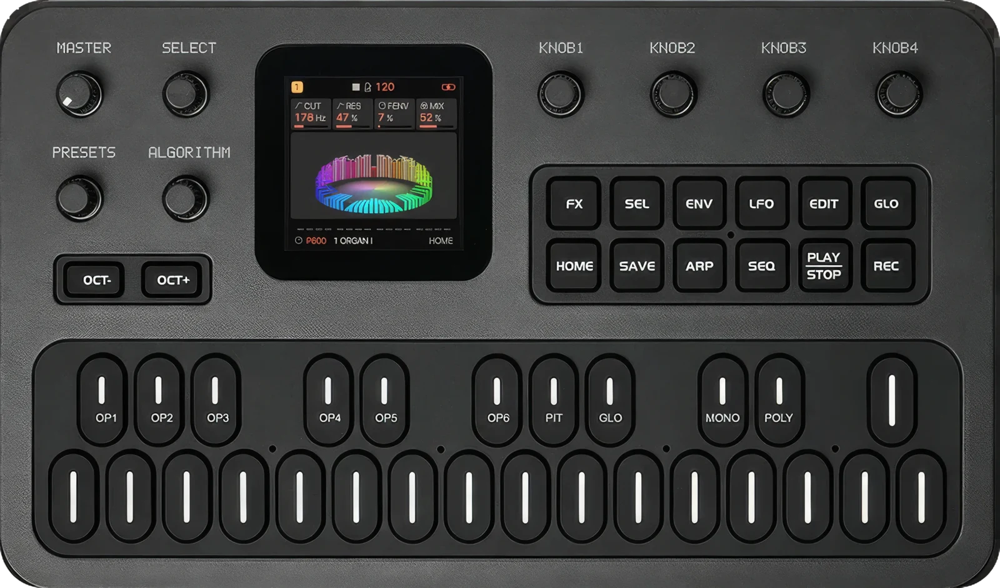
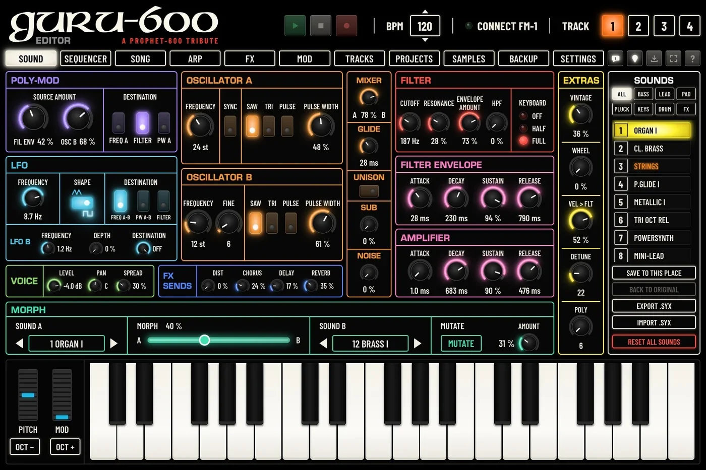
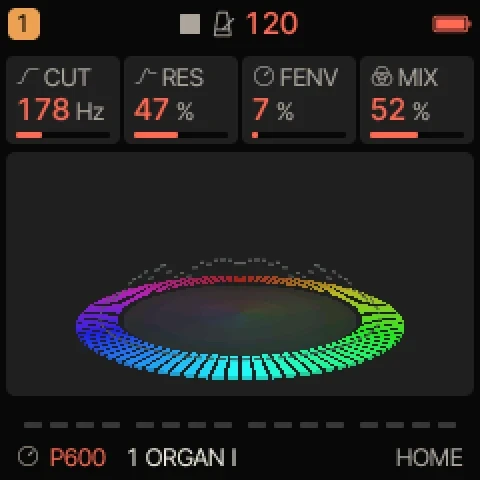
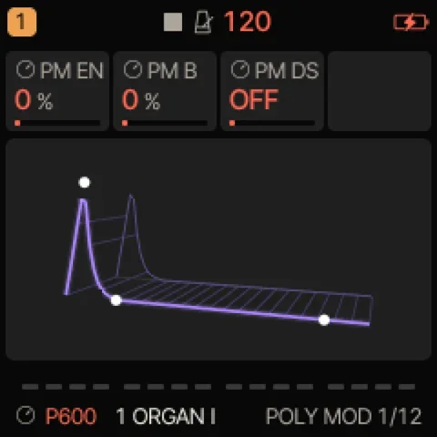
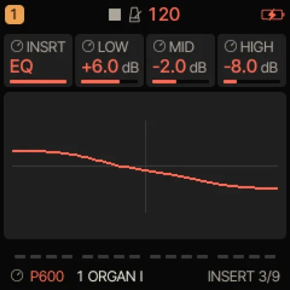
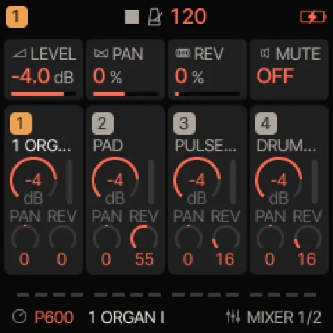

<b><a href="#english">English</a> · <a href="#francais">Français</a> · <a href="#deutsch">Deutsch</a> · <a href="#espanol">Español</a> · <a href="#italiano">Italiano</a> · <a href="#zhongwen">中文</a> · <a href="#nihongo">日本語</a></b>

 

<h1 align="center">
<picture>
<source media="(prefers-color-scheme: dark)" srcset="media/logo-dark.png">

</picture>
</h1>

 

<b>A Prophet-600 emulator firmware for the M-VAVE FM-1</b> <a href="https://github.com/MarcGoudy/guru-600/releases/tag/v1.4.0"><b>Version 1.4.0</b></a>

255 sounds · MORPH · a full editor · Mac and Windows applications · 7 languages

 

 

 

 

 

## English

**A Prophet-600 emulator firmware for the M-VAVE FM-1**, by Marc Massé, based on [Felucca](https://github.com/hugelton/Felucca) by Leo Kuroshita.

**Website: https://guru-600.com** (the sounds, the emulator to try in the browser, the downloads, in 7 languages)

The Guru-600 turns the M-VAVE FM-1 into an emulator of the Sequential Circuits Prophet-600 (1982), one of the very first synthesizers with MIDI. It replaces the FM-1's original firmware and can be removed at any time.

 

### What it adds

- **A P600 sound engine** built like the original: two oscillators per voice with sync, a 24 dB filter with its own envelope, Poly-Mod, an LFO, unison and six voices.
- **What 1982 could not do**: a high-pass filter, a sub-oscillator, white noise, a second LFO, Poly-Mod on oscillator A's pulse width, and eight voices instead of six if you choose. The factory sounds stay as they were made.
- **255 sounds**: the Prophet-600's 100 factory programs under their real names, 100 free sounds from the Prophet-600 community, and 55 sounds made for the Guru-600.
- **MORPH and MUTATE**: gradually turn one sound into another, your own USER sounds too, or create a variation of a sound in one gesture.
- **55 places of your own** for P600 sounds, in addition to the 32 USER places.
- **Prophet-600 sounds sent from a computer** (.syx), and back.
- **A chord memory**, a MIDI map that follows the GliGli firmware's, a new look and easier navigation.
- **A MIDI keyboard's knobs work at once** (an Arturia KeyStep as it comes, or any controller): the FM-1's four knobs, the filter, the envelope and a four-track mixer. And an equalizer per sound, and a screen reader for blind and visually impaired players.
- **Faster through the 324 sounds**: hold ENV while you turn PRESETS, ten sounds a detent.
- **Made for blind and visually impaired players too**: a screen reader, and the value you change shows in big type. Hold ENV and turn a knob: that setting back to the sound's own.
- **A complete backup** of the FM-1 with the Guru-600 editor: switch to another firmware, come back, and find the machine exactly as you left it.
- **The Guru-600 editor**, in the browser: the whole FM-1 on the computer's screen, as a panel inspired by the Prophet-600 with a keyboard: the P600 sounds, the sequencer, the song, the effects, the mix, the projects, the samples, the backup and the settings, with its own guide in 7 languages: **https://marcgoudy.github.io/guru-600/editor/**
- **A Mac application** (Apple silicon or Intel, macOS 10.13 and later) **and a Windows application** (Windows 10 and 11, 64-bit): the whole Guru-600 on the computer's screen, to discover it, prepare sounds or play without the FM-1. Their backups move to and from a FM-1.

Everything Felucca does remains: four tracks, thirteen other sound engines, a 64-step sequencer, an arpeggiator, effects, scales and chords, songs and projects.

 

### Install

1. Connect the FM-1 to the computer with a USB data cable.
2. Open the installation page in a MIDI-compatible browser (Chrome, Edge, Brave, Opera…): **https://marcgoudy.github.io/guru-600/**
3. Press **Install**, and do not unplug the cable or close the page during the installation.

The user guide (PDF, 7 languages), the editor for use without internet and its guide, and the Mac and Windows applications are in the [Releases](https://github.com/MarcGoudy/guru-600/releases).

On a Mac, download **Guru-600-Installer-Mac.dmg** and follow the three steps shown in its window: the Guru-600 is free and not certified by Apple, so this small installer puts it in Applications for you.

> **The Guru-600 is installed at your own risk**: the author accepts no responsibility if your FM-1 is damaged or misbehaves. The official M-VAVE firmware can be put back at any time with M-VAVE's own updater.

 

### A bug, an idea?

The Guru-600 is a free project, and it can always evolve. If you have an idea for a feature or an improvement, or if you find a bug, write to us here: [Issues](https://github.com/MarcGoudy/guru-600/issues) for bugs, [Discussions](https://github.com/MarcGoudy/guru-600/discussions) for ideas. Without a GitHub account: guru600fm1@gmail.com. For what comes from Felucca (the sequencer, the other engines…): [github.com/hugelton/Felucca](https://github.com/hugelton/Felucca).

 

### Source code and licenses

The Guru-600 is free software under the **GNU GPL-3.0** license, like Felucca. This repository holds its full source code (Felucca and the P600 engine), the tools (sound bank, start screen, user guide, site, tests) and the modified FM-1 emulator. See [firmware/BUILDING.md](firmware/BUILDING.md) to build the firmware.

Prophet-600 is a trademark of its owner; the Guru-600 is not affiliated with Sequential. M-VAVE and FM-1 are trademarks of their respective owners.

 

---

 

## Français

**Un firmware émulateur du Prophet-600 pour le M-VAVE FM-1**, par Marc Massé, d'après [Felucca](https://github.com/hugelton/Felucca) de Leo Kuroshita.

**Site : https://guru-600.com** (les sons, l'émulateur à essayer dans le navigateur, les téléchargements, en 7 langues)

Le Guru-600 transforme le M-VAVE FM-1 en émulateur du Prophet-600 de Sequential Circuits (1982), l'un des tout premiers synthétiseurs MIDI. Il remplace le firmware d'origine du FM-1 et peut être retiré à tout moment.

 

### Ce qu'il ajoute

- **Un moteur sonore P600** construit comme l'original : deux oscillateurs par voix avec synchronisation, un filtre 24 dB avec son enveloppe, la Poly-Mod, un LFO, l'unisson et six voix.
- **Ce que 1982 ne permettait pas** : un filtre passe-haut, un sous-oscillateur, un bruit blanc, un second LFO, la Poly-Mod sur la largeur d'impulsion de l'oscillateur A, et huit voix au lieu de six si vous le choisissez. Les sons d'usine restent tels qu'ils ont été créés.
- **255 sons** : les 100 programmes d'usine du Prophet-600 sous leurs vrais noms, 100 sons libres de la communauté du Prophet-600 et 55 sons créés pour le Guru-600.
- **MORPH et MUTATE** : transformer progressivement un son en un autre, vos sons USER compris, ou créer une variante d'un son en un geste.
- **55 places à vous** pour les sons P600, en plus des 32 emplacements USER.
- **Des sons Prophet-600 envoyés depuis un ordinateur** (.syx), et récupérés.
- **Une mémoire d'accords**, une table MIDI qui suit celle du firmware GliGli, un nouveau visage et une navigation plus simple.
- **Les boutons d'un clavier MIDI fonctionnent tout de suite** (un Arturia KeyStep tel qu'il sort de la boîte, ou tout contrôleur) : les quatre boutons du FM-1, le filtre, l'enveloppe et une table de mixage des quatre pistes. Et un égaliseur par son, et un lecteur d'écran pour les musiciens aveugles et malvoyants.
- **Parcourir les 324 sons plus vite** : maintenez ENV en tournant PRESETS, dix sons par cran.
- **Pensé aussi pour les musiciens aveugles et malvoyants** : un lecteur d'écran, et la valeur que vous changez s'affiche en grand. ENV maintenu + un bouton : ce réglage revient à celui du son.
- **Une sauvegarde complète** du FM-1 avec l'éditeur Guru-600 : passez à un autre firmware, revenez, et retrouvez la machine exactement telle que vous l'aviez laissée.
- **L'éditeur Guru-600**, dans le navigateur : tout le FM-1 sur l'écran de l'ordinateur, sous la forme d'une façade inspirée du Prophet-600, avec un clavier : les sons P600, le séquenceur, le morceau, les effets, le mixage, les projets, les échantillons, la sauvegarde et les réglages, avec son propre guide en 7 langues : **https://marcgoudy.github.io/guru-600/editor/**
- **Une application pour Mac** (puce Apple ou Intel, macOS 10.13 et plus récent) **et une pour Windows** (Windows 10 et 11, 64 bits) : tout le Guru-600 sur l'écran de l'ordinateur, pour le découvrir, préparer des sons ou jouer sans le FM-1. Leurs sauvegardes passent d'un FM-1 à l'application, et inversement.

Tout ce que fait Felucca demeure : quatre pistes, treize autres moteurs sonores, un séquenceur de 64 pas, un arpégiateur, des effets, des gammes et des accords, des morceaux et des projets.

 

### Installer

1. Branchez le FM-1 à l'ordinateur avec un câble USB de données.
2. Ouvrez la page d'installation dans un navigateur compatible MIDI (Chrome, Edge, Brave, Opera…) : **https://marcgoudy.github.io/guru-600/**
3. Cliquez sur **Installer**, et ne débranchez pas le câble ni ne fermez la page pendant l'installation.

La notice (PDF, 7 langues), l'éditeur à utiliser sans internet et son guide, et les applications pour Mac et Windows sont dans les [Releases](https://github.com/MarcGoudy/guru-600/releases).

Sur Mac, téléchargez **Guru-600-Installer-Mac.dmg** et suivez les trois étapes affichées dans sa fenêtre : le Guru-600 est gratuit et n'est pas certifié par Apple, ce petit installateur le place donc pour vous dans Applications.

> **Le Guru-600 s'installe à vos risques** : l'auteur décline toute responsabilité si votre FM-1 est endommagé ou fonctionne mal. Le firmware officiel de M-VAVE peut être remis à tout moment avec l'outil de mise à jour de M-VAVE.

 

### Un bug, une idée ?

Le Guru-600 est un projet libre, qui peut toujours évoluer. Si vous avez une idée de fonctionnalité ou d'amélioration, ou si vous constatez un bug, écrivez-nous ici : [Issues](https://github.com/MarcGoudy/guru-600/issues) pour les bugs, [Discussions](https://github.com/MarcGoudy/guru-600/discussions) pour les idées. Sans compte GitHub : guru600fm1@gmail.com. Pour ce qui vient de Felucca (le séquenceur, les autres moteurs…) : [github.com/hugelton/Felucca](https://github.com/hugelton/Felucca).

 

### Code source et licences

Le Guru-600 est un logiciel libre sous licence **GNU GPL-3.0**, comme Felucca. Ce dépôt contient son code source complet (Felucca et le moteur P600), les outils (banque de sons, écran de démarrage, notice, site, tests) et l'émulateur du FM-1 modifié. Voir [firmware/BUILDING.md](firmware/BUILDING.md) pour compiler le firmware.

Prophet-600 est une marque de son propriétaire ; le Guru-600 est sans lien avec Sequential. M-VAVE et FM-1 sont des marques de leurs propriétaires respectifs.

 

---

 

## Deutsch

**Eine Prophet-600-Emulator-Firmware für den M-VAVE FM-1**, von Marc Massé, basierend auf [Felucca](https://github.com/hugelton/Felucca) von Leo Kuroshita.

**Website: https://guru-600.com** (die Klänge, der Emulator zum Ausprobieren im Browser, die Downloads, in 7 Sprachen)

Der Guru-600 verwandelt den M-VAVE FM-1 in einen Emulator des Sequential Circuits Prophet-600 (1982), einen der allerersten Synthesizer mit MIDI. Er ersetzt die Original-Firmware des FM-1 und lässt sich jederzeit wieder entfernen.

 

### Was er hinzufügt

- **Eine P600-Klangerzeugung**, aufgebaut wie das Original: zwei Oszillatoren pro Stimme mit Sync, ein 24-dB-Filter mit eigener Hüllkurve, Poly-Mod, ein LFO, Unisono und sechs Stimmen.
- **Was 1982 nicht möglich war**: ein Hochpassfilter, ein Suboszillator, weißes Rauschen, ein zweiter LFO, Poly-Mod auf die Pulsbreite von Oszillator A und, nach Wahl, acht statt sechs Stimmen. Die Werksklänge bleiben, wie sie geschaffen wurden.
- **255 Sounds**: die 100 Werksprogramme des Prophet-600 unter ihren echten Namen, 100 freie Sounds aus der Prophet-600-Community und 55 für den Guru-600 geschaffene Sounds.
- **MORPH und MUTATE**: einen Sound schrittweise in einen anderen verwandeln, auch Ihre eigenen USER-Sounds, oder mit einer einzigen Geste eine Variante erzeugen.
- **55 eigene Plätze** für P600-Sounds, zusätzlich zu den 32 USER-Plätzen.
- **Prophet-600-Sounds vom Computer** (.syx) senden und zurückholen.
- **Ein Akkordspeicher**, eine MIDI-Belegung wie bei der GliGli-Firmware, ein neues Aussehen und eine einfachere Navigation.
- **Die Regler eines MIDI-Keyboards funktionieren sofort** (ein Arturia KeyStep ab Werk oder jeder Controller): die vier Regler des FM-1, der Filter, die Hüllkurve und ein Mischpult für die vier Spuren. Dazu ein Equalizer pro Klang und ein Bildschirmleser für blinde und sehbehinderte Musiker.
- **Schneller durch die 324 Klänge**: ENV gedrückt halten und PRESETS drehen, zehn Klänge pro Raste.
- **Auch für blinde und sehbehinderte Musiker gedacht**: ein Bildschirmleser, und der Wert, den Sie ändern, erscheint groß. ENV gedrückt + ein Regler: diese Einstellung zurück zum Klang.
- **Ein vollständiges Backup** des FM-1 mit dem Guru-600-Editor: Wechseln Sie zu einer anderen Firmware, kehren Sie zurück, und das Gerät ist genau so, wie Sie es verlassen haben.
- **Der Guru-600-Editor** im Browser: der ganze FM-1 auf dem Bildschirm, als ein vom Prophet-600 inspiriertes Bedienfeld mit Tastatur: die P600-Sounds, der Sequencer, der Song, die Effekte, der Mix, die Projekte, die Samples, das Backup und die Einstellungen, mit eigener Anleitung in 7 Sprachen: **https://marcgoudy.github.io/guru-600/editor/**
- **Eine Mac-Anwendung** (Apple Silicon oder Intel, ab macOS 10.13) **und eine Windows-Anwendung** (Windows 10 und 11, 64 Bit): der ganze Guru-600 auf dem Bildschirm, um ihn kennenzulernen, Sounds vorzubereiten oder ohne den FM-1 zu spielen. Ihre Backups lassen sich zwischen FM-1 und Anwendung austauschen.

Alles, was Felucca kann, bleibt erhalten: vier Spuren, dreizehn weitere Klangerzeugungen, ein 64-Schritt-Sequenzer, ein Arpeggiator, Effekte, Skalen und Akkorde, Songs und Projekte.

 

### Installation

1. Schließen Sie den FM-1 mit einem USB-Datenkabel an den Computer an.
2. Öffnen Sie die Installationsseite in einem MIDI-fähigen Browser (Chrome, Edge, Brave, Opera…): **https://marcgoudy.github.io/guru-600/**
3. Klicken Sie auf **Installieren**, und ziehen Sie während der Installation weder das Kabel ab noch schließen Sie die Seite.

Die Bedienungsanleitung (PDF, 7 Sprachen), der Editor zur Nutzung ohne Internet mit seiner Anleitung und die Mac- und Windows-Anwendungen finden Sie unter [Releases](https://github.com/MarcGoudy/guru-600/releases).

Auf dem Mac laden Sie **Guru-600-Installer-Mac.dmg** herunter und folgen den drei Schritten in seinem Fenster: Der Guru-600 ist kostenlos und nicht von Apple zertifiziert, deshalb legt ihn dieses kleine Installationsprogramm für Sie in Programme.

> **Die Installation des Guru-600 erfolgt auf eigene Gefahr**: Der Autor übernimmt keine Verantwortung, wenn Ihr FM-1 beschädigt wird oder nicht richtig funktioniert. Die offizielle M-VAVE-Firmware lässt sich jederzeit mit dem Update-Programm von M-VAVE wieder aufspielen.

 

### Ein Fehler, eine Idee?

Der Guru-600 ist ein freies Projekt und kann sich immer weiterentwickeln. Wenn Sie eine Idee für eine Funktion oder Verbesserung haben oder einen Fehler bemerken, schreiben Sie uns hier: [Issues](https://github.com/MarcGoudy/guru-600/issues) für Fehler, [Discussions](https://github.com/MarcGoudy/guru-600/discussions) für Ideen. Ohne GitHub-Konto: guru600fm1@gmail.com. Für alles, was von Felucca stammt (der Sequenzer, die anderen Klangerzeugungen…): [github.com/hugelton/Felucca](https://github.com/hugelton/Felucca).

 

### Quellcode und Lizenzen

Der Guru-600 ist freie Software unter der Lizenz **GNU GPL-3.0**, wie Felucca. Dieses Repository enthält den vollständigen Quellcode (Felucca und die P600-Klangerzeugung), die Werkzeuge (Soundbank, Startbildschirm, Anleitung, Website, Tests) und den angepassten FM-1-Emulator. Zum Kompilieren der Firmware siehe [firmware/BUILDING.md](firmware/BUILDING.md).

Prophet-600 ist eine Marke ihres Inhabers; der Guru-600 steht in keiner Verbindung zu Sequential. M-VAVE und FM-1 sind Marken ihrer jeweiligen Inhaber.

 

---

 

## Español

**Un firmware emulador del Prophet-600 para el M-VAVE FM-1**, de Marc Massé, basado en [Felucca](https://github.com/hugelton/Felucca) de Leo Kuroshita.

**Sitio web: https://guru-600.com** (los sonidos, el emulador para probar en el navegador, las descargas, en 7 idiomas)

El Guru-600 convierte el M-VAVE FM-1 en un emulador del Sequential Circuits Prophet-600 (1982), uno de los primeros sintetizadores con MIDI. Sustituye el firmware original del FM-1 y puede quitarse en cualquier momento.

 

### Lo que añade

- **Un motor de sonido P600** construido como el original: dos osciladores por voz con sincronización, un filtro de 24 dB con su propia envolvente, Poly-Mod, un LFO, unísono y seis voces.
- **Lo que 1982 no permitía**: un filtro paso alto, un suboscilador, un ruido blanco, un segundo LFO, la Poly-Mod sobre el ancho de pulso del oscilador A, y ocho voces en lugar de seis si lo elige. Los sonidos de fábrica siguen tal como se crearon.
- **255 sonidos**: los 100 programas de fábrica del Prophet-600 con sus nombres reales, 100 sonidos libres de la comunidad del Prophet-600 y 55 sonidos creados para el Guru-600.
- **MORPH y MUTATE**: transformar progresivamente un sonido en otro, también sus propios sonidos USER, o crear una variación de un sonido con un solo gesto.
- **55 lugares propios** para sonidos P600, además de las 32 posiciones USER.
- **Sonidos del Prophet-600 enviados desde un ordenador** (.syx), y recuperados.
- **Una memoria de acordes**, un mapa MIDI que sigue el del firmware GliGli, un nuevo aspecto y una navegación más sencilla.
- **Los potenciómetros de un teclado MIDI funcionan al instante** (un Arturia KeyStep tal como sale de la caja, o cualquier controlador): los cuatro potenciómetros del FM-1, el filtro, la envolvente y una mesa de mezclas de las cuatro pistas. Además, un ecualizador por sonido y un lector de pantalla para músicos ciegos y con baja visión.
- **Recorrer los 324 sonidos más rápido**: mantenga ENV mientras gira PRESETS, diez sonidos por paso.
- **Pensado también para músicos ciegos y con baja visión**: un lector de pantalla, y el valor que cambia se muestra en grande. ENV mantenido + un potenciómetro: ese ajuste vuelve al del sonido.
- **Una copia de seguridad completa** del FM-1 con el editor Guru-600: cambie a otro firmware, vuelva, y encuentre la máquina exactamente como la dejó.
- **El editor Guru-600**, en el navegador: todo el FM-1 en la pantalla del ordenador, como un panel inspirado en el Prophet-600, con un teclado: los sonidos P600, el secuenciador, la canción, los efectos, la mezcla, los proyectos, las muestras, la copia de seguridad y los ajustes, con su propia guía en 7 idiomas: **https://marcgoudy.github.io/guru-600/editor/**
- **Una aplicación para Mac** (Apple silicon o Intel, desde macOS 10.13) **y otra para Windows** (Windows 10 y 11, 64 bits): todo el Guru-600 en la pantalla del ordenador, para descubrirlo, preparar sonidos o tocar sin el FM-1. Sus copias de seguridad pasan del FM-1 a la aplicación, y al revés.

Todo lo que hace Felucca se mantiene: cuatro pistas, otros trece motores de sonido, un secuenciador de 64 pasos, un arpegiador, efectos, escalas y acordes, canciones y proyectos.

 

### Instalación

1. Conecte el FM-1 al ordenador con un cable USB de datos.
2. Abra la página de instalación en un navegador compatible con MIDI (Chrome, Edge, Brave, Opera…): **https://marcgoudy.github.io/guru-600/**
3. Pulse **Instalar**, y no desconecte el cable ni cierre la página durante la instalación.

El manual (PDF, 7 idiomas), el editor para usar sin internet y su guía, y las aplicaciones para Mac y Windows están en las [Releases](https://github.com/MarcGoudy/guru-600/releases).

En Mac, descargue **Guru-600-Installer-Mac.dmg** y siga los tres pasos que muestra su ventana: el Guru-600 es gratuito y no está certificado por Apple, así que este pequeño instalador lo coloca por usted en Aplicaciones.

> **El Guru-600 se instala bajo su propio riesgo**: el autor no se hace responsable si su FM-1 resulta dañado o funciona mal. El firmware oficial de M-VAVE puede volver a instalarse en cualquier momento con el actualizador de M-VAVE.

 

### ¿Un error, una idea?

El Guru-600 es un proyecto libre, que siempre puede evolucionar. Si tiene una idea de función o de mejora, o si detecta un error, escríbanos aquí: [Issues](https://github.com/MarcGoudy/guru-600/issues) para los errores, [Discussions](https://github.com/MarcGoudy/guru-600/discussions) para las ideas. Sin cuenta de GitHub: guru600fm1@gmail.com. Para lo que viene de Felucca (el secuenciador, los demás motores…): [github.com/hugelton/Felucca](https://github.com/hugelton/Felucca).

 

### Código fuente y licencias

El Guru-600 es software libre bajo la licencia **GNU GPL-3.0**, como Felucca. Este repositorio contiene su código fuente completo (Felucca y el motor P600), las herramientas (banco de sonidos, pantalla de inicio, manual, sitio, pruebas) y el emulador del FM-1 modificado. Para compilar el firmware, consulte [firmware/BUILDING.md](firmware/BUILDING.md).

Prophet-600 es una marca de su propietario; el Guru-600 no tiene relación con Sequential. M-VAVE y FM-1 son marcas de sus respectivos propietarios.

 

---

 

## Italiano

**Un firmware emulatore del Prophet-600 per l'M-VAVE FM-1**, di Marc Massé, basato su [Felucca](https://github.com/hugelton/Felucca) di Leo Kuroshita.

**Sito: https://guru-600.com** (i suoni, l'emulatore da provare nel browser, i download, in 7 lingue)

Il Guru-600 trasforma l'M-VAVE FM-1 in un emulatore del Sequential Circuits Prophet-600 (1982), uno dei primissimi sintetizzatori dotati di MIDI. Sostituisce il firmware originale dell'FM-1 e si può rimuovere in qualsiasi momento.

 

### Cosa aggiunge

- **Un motore sonoro P600** costruito come l'originale: due oscillatori per voce con sync, un filtro da 24 dB con il suo inviluppo, la Poly-Mod, un LFO, l'unisono e sei voci.
- **Ciò che il 1982 non permetteva**: un filtro passa-alto, un suboscillatore, un rumore bianco, un secondo LFO, la Poly-Mod sulla larghezza d'impulso dell'oscillatore A, e otto voci invece di sei, a scelta. I suoni di fabbrica restano come sono stati creati.
- **255 suoni**: i 100 programmi di fabbrica del Prophet-600 con i loro veri nomi, 100 suoni liberi della comunità del Prophet-600 e 55 suoni creati per il Guru-600.
- **MORPH e MUTATE**: trasformare gradualmente un suono in un altro, anche i vostri suoni USER, o creare una variante di un suono con un solo gesto.
- **55 posti tutti vostri** per i suoni P600, oltre alle 32 posizioni USER.
- **Suoni del Prophet-600 inviati da un computer** (.syx), e recuperati.
- **Una memoria degli accordi**, una mappa MIDI che segue quella del firmware GliGli, un nuovo aspetto e una navigazione più semplice.
- **Le manopole di una tastiera MIDI funzionano subito** (un Arturia KeyStep così com'è, o qualsiasi controller): le quattro manopole del FM-1, il filtro, l'inviluppo e un mixer delle quattro tracce. In più un equalizzatore per suono e un lettore di schermo per musicisti ciechi e ipovedenti.
- **Scorrere i 324 suoni più in fretta**: tenete premuto ENV mentre girate PRESETS, dieci suoni a scatto.
- **Pensato anche per musicisti ciechi e ipovedenti**: un lettore di schermo, e il valore che cambiate appare in grande. ENV tenuto + una manopola: quell'impostazione torna a quella del suono.
- **Un backup completo** dell'FM-1 con l'editor Guru-600: passate a un altro firmware, tornate indietro, e ritrovate la macchina esattamente come l'avevate lasciata.
- **L'editor Guru-600**, nel browser: tutto l'FM-1 sullo schermo del computer, come un pannello ispirato al Prophet-600, con una tastiera: i suoni P600, il sequencer, la song, gli effetti, il mix, i progetti, i campioni, il backup e le impostazioni, con la sua guida in 7 lingue: **https://marcgoudy.github.io/guru-600/editor/**
- **Un'applicazione per Mac** (Apple silicon o Intel, da macOS 10.13) **e una per Windows** (Windows 10 e 11, 64 bit): tutto il Guru-600 sullo schermo del computer, per scoprirlo, preparare suoni o suonare senza l'FM-1. I loro backup passano dall'FM-1 all'applicazione, e viceversa.

Tutto ciò che fa Felucca resta: quattro tracce, altri tredici motori sonori, un sequencer a 64 passi, un arpeggiatore, effetti, scale e accordi, brani e progetti.

 

### Installazione

1. Collegare l'FM-1 al computer con un cavo USB dati.
2. Aprire la pagina di installazione in un browser compatibile MIDI (Chrome, Edge, Brave, Opera…): **https://marcgoudy.github.io/guru-600/**
3. Premere **Installa**, e non scollegare il cavo né chiudere la pagina durante l'installazione.

Il manuale (PDF, 7 lingue), l'editor da usare senza internet con la sua guida e le applicazioni per Mac e Windows sono nelle [Releases](https://github.com/MarcGoudy/guru-600/releases).

Su Mac, scaricate **Guru-600-Installer-Mac.dmg** e seguite i tre passaggi indicati nella sua finestra: il Guru-600 è gratuito e non è certificato da Apple, quindi questo piccolo programma di installazione lo mette per voi in Applicazioni.

> **Il Guru-600 si installa a proprio rischio**: l'autore declina ogni responsabilità se l'FM-1 viene danneggiato o non funziona bene. Il firmware ufficiale di M-VAVE si può rimettere in qualsiasi momento con lo strumento di aggiornamento di M-VAVE.

 

### Un bug, un'idea?

Il Guru-600 è un progetto libero, che può sempre evolvere. Se avete un'idea per una funzione o un miglioramento, o se notate un bug, scriveteci qui: [Issues](https://github.com/MarcGoudy/guru-600/issues) per i bug, [Discussions](https://github.com/MarcGoudy/guru-600/discussions) per le idee. Senza un account GitHub: guru600fm1@gmail.com. Per ciò che viene da Felucca (il sequencer, gli altri motori…): [github.com/hugelton/Felucca](https://github.com/hugelton/Felucca).

 

### Codice sorgente e licenze

Il Guru-600 è software libero con licenza **GNU GPL-3.0**, come Felucca. Questo repository contiene il codice sorgente completo (Felucca e il motore P600), gli strumenti (banco di suoni, schermata di avvio, manuale, sito, test) e l'emulatore dell'FM-1 modificato. Per compilare il firmware, vedere [firmware/BUILDING.md](firmware/BUILDING.md).

Prophet-600 è un marchio del suo proprietario; il Guru-600 non è affiliato a Sequential. M-VAVE e FM-1 sono marchi dei rispettivi proprietari.

 

---

 

## 中文

**一款用于 M-VAVE FM-1 的 Prophet-600 模拟器固件**，作者 Marc Massé，基于 Leo Kuroshita 的 [Felucca](https://github.com/hugelton/Felucca)。

<b>网站：https://guru-600.com</b>（音色、可在浏览器中试用的模拟器、下载，共 7 种语言）

Guru-600 将 M-VAVE FM-1 变成 Sequential Circuits Prophet-600（1982 年）的模拟器，Prophet-600 是最早配备 MIDI 的合成器之一。它会取代 FM-1 的原厂固件，可随时卸载。

 

### 新增功能

- **P600 音色引擎**，按原机结构打造：每个声部两个可同步的振荡器、带独立包络的 24 dB 滤波器、Poly-Mod、LFO、齐奏和六个声部。
- **1982 年做不到的功能**：高通滤波器、副振荡器、白噪声、第二个 LFO、作用于振荡器 A 脉冲宽度的 Poly-Mod，还可选择八个复音而不是六个。出厂音色保持原样。
- **255 个音色**：Prophet-600 的 100 个出厂程序（沿用原名）、Prophet-600 社区的 100 个免费音色，以及为 Guru-600 制作的 55 个音色。
- **MORPH 与 MUTATE**：将一个音色逐渐变为另一个音色（包括您自己的 USER 音色），或一个动作就生成某个音色的变体。
- **55 个属于您的位置**，用于存放 P600 音色，另有 32 个 USER 位置。
- **从电脑发送 Prophet-600 音色**（.syx），也可以取回。
- **和弦记忆**、沿用 GliGli 固件的 MIDI 对应表、全新的外观和更简便的操作。
- **MIDI 键盘的旋钮即插即用**（开箱即用的 Arturia KeyStep 或任何控制器）：FM-1 的四个旋钮、滤波器、包络和四音轨调音台。另有每个音色的均衡器，以及为盲人和视障乐手准备的屏幕阅读器。
- **更快浏览 324 个音色**：按住 ENV 同时转动 PRESETS，每一格跳十个音色。
- **同样为盲人和视障乐手设计**：屏幕阅读器，以及正在调整的数值放大显示。按住 ENV 并转动旋钮：该设置恢复为音色自身的数值。
- **FM-1 的完整备份**（使用 Guru-600 编辑器）：换用其他固件后再换回来，设备会完全恢复到您离开时的状态。
- **Guru-600 编辑器**（在浏览器中）：在电脑屏幕上呈现完整的 FM-1，形式为一块受 Prophet-600 启发、带键盘的面板：P600 音色、音序器、歌曲、效果、混音、工程、采样、备份和设置，并附有 7 种语言的专属指南：**https://marcgoudy.github.io/guru-600/editor/**
- **Mac 应用程序**（Apple 芯片或 Intel，macOS 10.13 及以上）**和 Windows 应用程序**（Windows 10 和 11，64 位）：在电脑屏幕上使用完整的 Guru-600，用来熟悉它、准备音色或在没有 FM-1 时演奏。其备份可以在 FM-1 和应用程序之间互相传递。

Felucca 的所有功能都保留：四条音轨、另外十三个音色引擎、64 步音序器、琶音器、效果器、音阶与和弦、乐曲和工程。

 

### 安装

1. 用 USB 数据线将 FM-1 连接到电脑。
2. 在支持 MIDI 的浏览器（Chrome、Edge、Brave、Opera……）中打开安装页面：**https://marcgoudy.github.io/guru-600/**
3. 点击 **安装**，安装过程中请勿拔下数据线，也不要关闭页面。

用户指南（PDF，7 种语言）、无网络时使用的编辑器及其指南，以及 Mac 和 Windows 应用程序位于 [Releases](https://github.com/MarcGoudy/guru-600/releases)。

在 Mac 上，请下载 **Guru-600-Installer-Mac.dmg** 并按照其窗口中的三个步骤操作：Guru-600 是免费的，没有经过 Apple 认证，因此由这个小安装程序为您放入“应用程序”。

> <b>安装 Guru-600 风险自负</b>：如果您的 FM-1 损坏或工作异常，作者概不负责。您可以随时用 M-VAVE 的更新工具装回 M-VAVE 官方固件。

 

### 发现错误或有想法？

Guru-600 是一个自由项目，可以不断发展。如果您有功能或改进的想法，或者发现了错误，请在这里联系我们：错误请提交 [Issues](https://github.com/MarcGoudy/guru-600/issues)，想法请发到 [Discussions](https://github.com/MarcGoudy/guru-600/discussions)。没有 GitHub 账号：guru600fm1@gmail.com。与 Felucca 有关的内容（音序器、其他引擎……）：[github.com/hugelton/Felucca](https://github.com/hugelton/Felucca)。

 

### 源代码与许可证

Guru-600 是自由软件，与 Felucca 一样采用 **GNU GPL-3.0** 许可证。本仓库包含其完整源代码（Felucca 和 P600 引擎）、工具（音色库、启动画面、用户指南、网站、测试）以及修改后的 FM-1 模拟器。编译固件请参阅 [firmware/BUILDING.md](firmware/BUILDING.md)。

Prophet-600 是其所有者的商标；Guru-600 与 Sequential 无关。M-VAVE 和 FM-1 是其各自所有者的商标。

 

---

 

## 日本語

**M-VAVE FM-1 用の Prophet-600 エミュレーター・ファームウェア**。作者は Marc Massé、Leo Kuroshita による [Felucca](https://github.com/hugelton/Felucca) をベースにしています。

<b>ウェブサイト：https://guru-600.com</b>（サウンド、ブラウザで試せるエミュレーター、ダウンロード、7 言語）

Guru-600 は、M-VAVE FM-1 を、MIDI を搭載した最初期のシンセサイザーの一つである Sequential Circuits Prophet-600（1982年）のエミュレーターに変えます。FM-1 の純正ファームウェアと置き換わり、いつでも元に戻せます。

 

### 追加される機能

- **P600 サウンド・エンジン**：オリジナルと同じ構成で、ボイスごとにシンク可能な 2 つのオシレーター、専用エンベロープ付きの 24 dB フィルター、Poly-Mod、LFO、ユニゾン、6 ボイスを備えています。
- **1982 年にはできなかったこと**：ハイパス・フィルター、サブ・オシレーター、ホワイト・ノイズ、2 つ目の LFO、オシレーター A のパルス幅への Poly-Mod、そして選べば 6 ボイスではなく 8 ボイス。ファクトリー・サウンドは作られたときのままです。
- **255 のサウンド**：Prophet-600 の 100 のファクトリー・プログラムを本来の名前のまま収録し、さらに Prophet-600 コミュニティによる無料サウンド 100 種と、Guru-600 のために作られた 55 種を加えています。
- **MORPH と MUTATE**：あるサウンドを別のサウンドへ徐々に変化させたり（自分の USER サウンドも使えます）、ワン・アクションでサウンドのバリエーションを作ったりできます。
- **P600 サウンド用の自分の枠 55**。USER 枠 32 とは別にあります。
- **コンピューターから Prophet-600 のサウンドを送信**（.syx）し、取り戻すこともできます。
- **コード・メモリー**、GliGli ファームウェアと同じ MIDI マップ、新しい外観、よりシンプルな操作。
- **MIDI キーボードのノブがすぐに使えます**（箱から出したままの Arturia KeyStep、またはどんなコントローラーでも）：FM-1 の4つのノブ、フィルター、エンベロープ、4トラックのミキサー。さらにサウンドごとのイコライザーと、目の不自由な演奏者のためのスクリーンリーダー。
- **324 の音色をすばやく選ぶ**：ENV を押したまま PRESETS を回すと、1 クリックで 10 音色ずつ進みます。
- **目の不自由な演奏者にも配慮**：スクリーンリーダーと、変更中の値の拡大表示。ENV を押したままノブを回すと、その設定が音色本来の値に戻ります。
- **Guru-600 エディターによる FM-1 の完全バックアップ**：別のファームウェアに切り替えて戻しても、機器は離れたときとまったく同じ状態に戻ります。
- **Guru-600 エディター**（ブラウザーで使用）：FM-1 のすべてを、Prophet-600 にインスパイアされた鍵盤付きのパネルとしてコンピューターの画面に表示します。P600 サウンド、シーケンサー、ソング、エフェクト、ミックス、プロジェクト、サンプル、バックアップ、設定。7 言語の専用ガイド付き：**https://marcgoudy.github.io/guru-600/editor/**
- **Mac 用アプリケーション**（Apple シリコンまたは Intel、macOS 10.13 以降）**と Windows 用アプリケーション**（Windows 10・11、64 ビット）：Guru-600 のすべてをコンピューターの画面で使えます。試したり、サウンドを準備したり、FM-1 なしで演奏したりできます。バックアップは FM-1 とアプリケーションの間でやり取りできます。

Felucca の機能はすべてそのまま使えます：4 トラック、ほかの 13 のサウンド・エンジン、64 ステップのシーケンサー、アルペジエーター、エフェクト、スケールとコード、ソングとプロジェクト。

 

### インストール

1. USB データ・ケーブルで FM-1 をコンピューターに接続します。
2. MIDI 対応のブラウザー（Chrome、Edge、Brave、Opera など）でインストール・ページを開きます：**https://marcgoudy.github.io/guru-600/**
3. **インストール** を押します。インストール中はケーブルを抜いたり、ページを閉じたりしないでください。

ユーザーガイド（PDF、7 言語）、インターネットなしで使えるエディターとそのガイド、Mac 用と Windows 用のアプリケーションは [Releases](https://github.com/MarcGoudy/guru-600/releases) にあります。

Mac では **Guru-600-Installer-Mac.dmg** をダウンロードし、ウインドウに表示される 3 つの手順に従ってください。Guru-600 は無料で Apple の認証を受けていないため、この小さなインストーラーが「アプリケーション」に入れます。

> <b>Guru-600 のインストールは自己責任でお願いします</b>：FM-1 が損傷したり正常に動作しなくなったりしても、作者は一切責任を負いません。M-VAVE の公式ファームウェアは、M-VAVE のアップデーターでいつでも元に戻せます。

 

### バグやアイデアは？

Guru-600 はフリーなプロジェクトで、これからも進化し続けます。機能や改善のアイデアがあるとき、またはバグを見つけたときは、こちらでお知らせください。バグは [Issues](https://github.com/MarcGoudy/guru-600/issues) に、アイデアは [Discussions](https://github.com/MarcGoudy/guru-600/discussions) にどうぞ。GitHub アカウントがない場合：guru600fm1@gmail.com。Felucca に由来するもの（シーケンサー、ほかのエンジンなど）は：[github.com/hugelton/Felucca](https://github.com/hugelton/Felucca)。

 

### ソースコードとライセンス

Guru-600 は Felucca と同じく **GNU GPL-3.0** ライセンスのフリーソフトウェアです。このリポジトリには、完全なソースコード（Felucca と P600 エンジン）、ツール（サウンド・バンク、起動画面、ユーザーガイド、サイト、テスト）、改変した FM-1 エミュレーターが含まれています。ファームウェアのビルド方法は [firmware/BUILDING.md](firmware/BUILDING.md) を参照してください。

Prophet-600 はその所有者の商標です。Guru-600 は Sequential とは無関係です。M-VAVE と FM-1 は各所有者の商標です。
